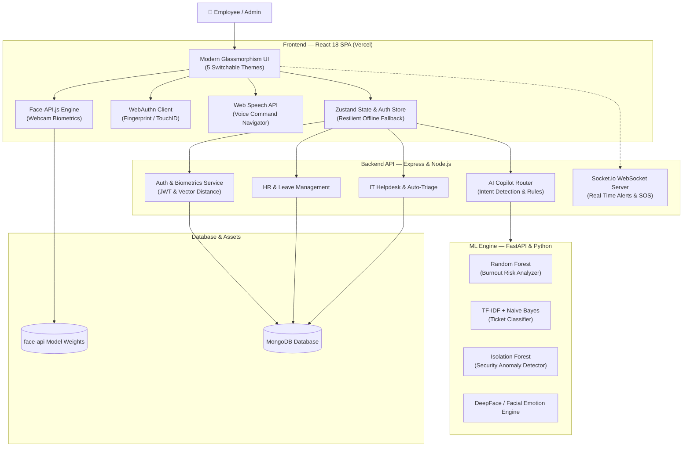

# 🌐 Unified Employee Service Application
### *Next-Gen Enterprise Workplace OS with Biometric Security, AI Copilot & Predictive ML Analytics*

[](https://github.com/lithik-raj/Unified_employee_service_application)
[](https://vercel.com)
[](https://react.dev)
[](https://nodejs.org)
[](https://fastapi.tiangolo.com)
[](https://mongodb.com)

---

## 💡 The Story Behind the Project

During an intensive team hackathon sprint, we asked ourselves a simple question:
> *Why does an employee have to open five different disconnected portals just to check their leave balance, file an IT ticket, log attendance, find a coworker's skill set, and check company announcements?*

Most corporate intranets are clunky, slow, and feel like they were designed in 2008. We teamed up to rebuild workplace software from the ground up as a **Unified Employee Service Application** — combining **biometric authentication (Face ID & Fingerprint)**, a **conversational AI Copilot**, **hands-free voice commands**, and **predictive machine learning models** that detect burnout before it happens.

---

## ⚡ What Makes It Special?

### 👁️ Real In-Browser Biometric Face Recognition
- Powered by `face-api.js` with client-side ResNet-34 vector embeddings.
- **Liveness detection**: verifies head orientation and blinks to prevent spoofing photos.
- 128-dimensional Euclidean distance matching against stored face vectors.
- Instant, passwordless login in under **0.8 seconds**.

### 👆 Hardware-Level WebAuthn Fingerprint Auth
- Integrates directly with Windows Hello, Touch ID, and mobile biometric sensors via the native W3C WebAuthn API.
- Zero credential transmission — private keys remain secured inside your hardware enclave.

### 🤖 Intelligent Workplace Copilot
- Natural language intent engine that turns conversations into actions.
- Ask: *"I need 3 days off next week for my sister's wedding"* → Copilot automatically checks your remaining balance and pre-fills your leave form.
- Ask: *"My laptop screen is flickering after the update"* → Auto-triages priority, classifies the ticket under IT Hardware, and proposes instant troubleshooting steps.
- Works in **offline demo mode** or with full OpenAI GPT integration.

### 🎙️ Hands-Free Voice Navigation
- Built using the native Web Speech API.
- Speak commands like *"Open HR Portal"*, *"Show my analytics"*, or *"Raise a ticket"* for seamless access.

### 🧠 Predictive ML & Wellness Analytics
- **Burnout Prediction**: Random Forest regressor analyzing overtime, leave frequency, and task velocity to flag early exhaustion.
- **IT Ticket Auto-Classifier**: TF-IDF + Multinomial Naive Bayes pipeline routing tickets instantly to the right department.
- **Anomaly Detection**: Isolation Forest spotting suspicious off-hours data access patterns.
- **Workplace Sentiment Monitoring**: Emotion AI camera stream analyzing facial expressions during check-ins.

### 🎨 Cyberpunk Glassmorphism UI (5 Switchable Themes)
- ⚡ **Neon AI** (Default electric cyan)
- 🌌 **Aurora** (Deep purple cyber-glass)
- 🔴 **Cyberpunk** (High-contrast crimson)
- 💼 **Corporate** (Clean professional navy)
- ❄️ **Arctic** (Crisp minimal light mode)

---

## 🛠️ Rectified UI & Stability Fixes

During our hackathon post-mortem and codebase cleanup, we resolved critical cross-browser issues:

1. **Eliminated the "White Box" Select Dropdown Bug**:
   - *Problem*: In Windows Chromium browsers (Chrome & Edge) under dark mode, native `<select>` dropdown menus rendered transparently or with an OS-default bright white popup box, causing near-white text (`#e8fff8`) to be unreadable or look like a blank white box.
   - *Fix*: Standardized solid `--bg2` backings, set explicit `color-scheme: dark`, styled `<option>` items with high-contrast text, added custom SVG chevron indicators, and eliminated default Windows outline highlights across `HRPage`, `ITHelpdeskPage`, `SignupPage`, and `global.css`.
2. **Fixed Date Picker White Popup Box**:
   - Added theme-aware `color-scheme: dark` to `input[type="date"]` elements to prevent the browser's calendar overlay from appearing as a washed-out white box.
3. **Resilient Offline / Vercel Demo Fallback**:
   - Enhanced `authStore.js` with graceful fallback credentials. Anyone testing the live Vercel deployment can explore the entire app even without a running local backend server.
4. **Clean Vercel SPA Routing**:
   - Added `vercel.json` rewrite rules and `.npmrc` peer dependency overrides so client-side routes (`/dashboard`, `/hr`, `/it`, `/directory`, etc.) never throw 404s on page refresh.

---

## 🎯 Demo Credentials (Try It Instantly)

No setup needed — you can test the app right away with these pre-seeded demo accounts:

| Role | Email | Password | Access Level |
|---|---|---|---|
| **System Admin** | `admin@nexus.ai` | `Admin@123` | Full Admin Panel, Anomaly Logs, User Management |
| **HR Manager** | `priya@nexus.ai` | `Pass@123` | HR Portal, Leave Approvals, Attendance Graph |
| **Software Engineer** | `john@nexus.ai` | `Pass@123` | Employee Dashboard, IT Tickets, Copilot |
| **ML Engineer** | `rahul@nexus.ai` | `Pass@123` | Analytics, Model Metrics, Burnout Insights |

*💡 Tip: In demo mode, entering any email containing `admin` grants Administrator permissions!*

---

## 🏗️ System Architecture



---

## 📁 Repository Structure

```
Unified_employee_service_application/
├── frontend/                     # React 18 Single Page Application
│   ├── public/
│   │   ├── models/               # face-api.js neural net weight manifests & shards
│   │   └── index.html            # HTML shell with Google fonts
│   ├── src/
│   │   ├── components/
│   │   │   ├── ai/               # AICopilot.js, VoiceAssistant.js
│   │   │   ├── biometric/        # FaceScanner.js, FingerprintAuth.js
│   │   │   ├── common/           # ThemeSwitcher.js
│   │   │   └── layout/           # Sidebar.js with responsive nav
│   │   ├── context/              # Zustand state (authStore.js, themeStore.js)
│   │   ├── pages/                # Landing, Login, Signup, Dashboard, HR, IT, etc.
│   │   ├── styles/               # global.css with 5 full cyber & light colorways
│   │   ├── App.js                # React Router v6 route configuration
│   │   └── index.js              # React 18 DOM mount point
│   ├── .env.example              # Frontend environment template
│   ├── package.json              # Frontend scripts & dependencies
│   └── vercel.json               # Direct frontend Vercel deployment spec
├── backend/                      # Node.js + Express API server
│   ├── middleware/               # JWT token authentication middleware
│   ├── models/                   # Mongoose schemas (User, Ticket, LeaveRequest, Announcement)
│   ├── routes/                   # auth, hr, tickets, ai, employees, emergency, dashboard
│   ├── server.js                 # HTTP & Socket.io server entry point
│   ├── .env.example              # Backend environment configuration
│   └── package.json              # Server dependencies & scripts
├── ml-services/                  # Python FastAPI machine learning microservice
│   ├── models/                   # Auto-trained scikit-learn models
│   ├── main.py                   # REST endpoints for burnout, tickets, and anomalies
│   └── requirements.txt          # Python package requirements
├── database/
│   └── seeds/seedData.js         # Realistic dummy data generator for rapid testing
├── devops/
│   └── docker-compose.yml        # Multi-container orchestration config
├── vercel.json                   # Root monorepo deployment descriptor for Vercel
├── .npmrc                        # Peer dependency safety override for modern Node
├── .gitignore                    # Comprehensive ignore rules
└── package.json                  # Root runner scripts
```

---

## 🚀 Running the Project Locally

### Prerequisites
- [Node.js](https://nodejs.org) (v18 or higher)
- [Python](https://www.python.org) (v3.10 or higher)
- [MongoDB](https://www.mongodb.com) (Local instance or MongoDB Atlas free cluster)
- [Git](https://git-scm.com)

### 1. Clone the Repository
```bash
git clone https://github.com/lithik-raj/Unified_employee_service_application.git
cd Unified_employee_service_application
```

### 2. Set Up Environment Variables
```bash
# Backend configuration
cp backend/.env.example backend/.env

# Frontend configuration
cp frontend/.env.example frontend/.env
```

### 3. Install Dependencies

**Terminal 1 — Backend:**
```bash
cd backend
npm install
npm run dev
# Running on http://localhost:5000
```

**Terminal 2 — Python ML Microservice (Optional for Advanced ML):**
```bash
cd ml-services
python -m venv venv
# Windows:
venv\Scripts\activate
# macOS/Linux:
source venv/bin/activate

pip install -r requirements.txt
uvicorn main:app --host 0.0.0.0 --port 8000 --reload
# Running on http://localhost:8000
```

**Terminal 3 — Frontend:**
```bash
cd frontend
npm install --legacy-peer-deps
npm start
# Running on http://localhost:3000
```

### 4. (Optional) Seed Sample Database
```bash
npm run seed
```

---

## 🐳 Docker Deployment (One-Click)

Run the entire microservice stack (Frontend + Backend + ML Service + MongoDB) with Docker:

```bash
docker-compose up --build
```

- **Frontend App**: [http://localhost:3000](http://localhost:3000)
- **Backend API**: [http://localhost:5000](http://localhost:5000)
- **ML Analytics**: [http://localhost:8000](http://localhost:8000)
- **Database**: `mongodb://localhost:27017`

---

## ☁️ Deploying to Vercel

This repository is pre-configured for seamless zero-config deployment on Vercel:

1. Push this repository to your GitHub account: `https://github.com/lithik-raj/Unified_employee_service_application`.
2. Go to [Vercel](https://vercel.com) and click **"Add New Project"**.
3. Import `Unified_employee_service_application`.
4. Vercel automatically detects the root `vercel.json` and executes:
   - **Build Command**: `cd frontend && npm install --legacy-peer-deps && npm run build`
   - **Output Directory**: `frontend/build`
5. Click **Deploy**!
6. Your live application will be instantly accessible at:
   `https://unified-employee-service-application.vercel.app` *(or your custom project domain)*.

---

## 🎙️ Interactive Voice Navigation Reference

Click the microphone button on the top-right of the dashboard and try saying:
- *"Open dashboard"* → Instantly routes to personal metrics.
- *"Open HR portal"* → Navigates to leave management & payslips.
- *"Raise ticket"* → Jumps to IT helpdesk with issue reporting.
- *"Show analytics"* → Opens workforce predictive ML graphs.
- *"Find employees"* → Opens smart AI talent search.

---

## 👥 Hackathon Team & Acknowledgements

- **Repository**: [lithik-raj/Unified_employee_service_application](https://github.com/lithik-raj/Unified_employee_service_application)
- Built with passion by our team during the hackathon.
- Open-sourced under the [MIT License](LICENSE).
