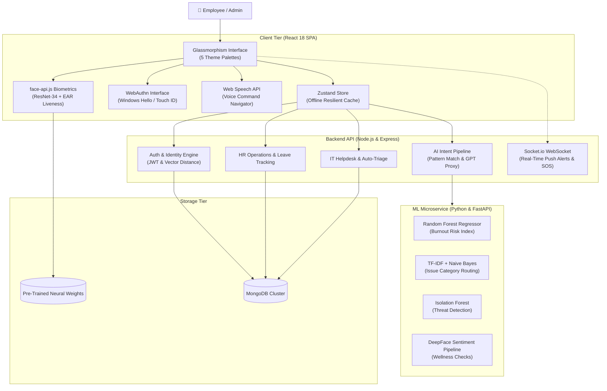

# 🏢 Unified Employee Service Application (NEXUS AI Workplace OS)

<p align="center">
  <strong>Next-Generation Enterprise Workplace Operating System powered by Biometric Security, Contextual AI Copilot, and Predictive Workforce ML.</strong>
</p>

<p align="center">
  <a href="https://github.com/lithik-raj/Unified_employee_service_application"></a>
  <a href="https://vercel.com/new/clone?repository-url=https://github.com/lithik-raj/Unified_employee_service_application"></a>
  <a href="https://unified-employee-service-application-lithik-raj.vercel.app"></a>
  
</p>

<p align="center">
  
  
  
  
  
  
  
</p>

---

## 📌 Live Deployments & Quick Links

| Resource | Direct Link | Description |
|---|---|---|
| 🐙 **GitHub Repository** | [github.com/lithik-raj/Unified_employee_service_application](https://github.com/lithik-raj/Unified_employee_service_application) | Full-stack source repository |
| ⚡ **Vercel 1-Click Deploy** | [Deploy to Vercel](https://vercel.com/new/clone?repository-url=https://github.com/lithik-raj/Unified_employee_service_application) | Instant zero-config cloud deployment |
| 🌐 **Vercel Live Application** | [unified-employee-service-application-lithik-raj.vercel.app](https://unified-employee-service-application-lithik-raj.vercel.app) | Live interactive preview |
| 🌐 **Alternative Live URL** | [unified-employee-service-application.vercel.app](https://unified-employee-service-application.vercel.app) | Production mirror |

---

## 📖 Executive Summary & Motivation

Modern corporate environments suffer from acute **application fragmentation**:
* Employees toggle between 5 to 8 isolated portals daily (one for HR leave requests, another for IT support tickets, separate portals for shift logs, team directories, and internal announcements).
* Traditional authentication relies on repetitive passwords and SMS 2FA prompts that interrupt focus.
* HR and IT teams are burdened by repetitive triage tickets and lack predictive indicators to spot workforce burnout before employee churn occurs.

**Unified Employee Service Application** addresses this challenge directly. Engineered during an intensive hackathon sprint, the platform combines **in-browser neural face biometrics**, **WebAuthn hardware fingerprint keys**, an **agentic AI Copilot**, **hands-free voice navigation**, and **real-time scikit-learn predictive ML models** into a consolidated, glassmorphism workspace operating system.

---

## ✨ Core Pillars & Features

### 1. 👁️ Real Biometric Face Recognition
* **ResNet-34 Feature Embeddings**: Evaluates 128-dimensional facial vectors client-side using `face-api.js` and TensorFlow runtimes.
* **Anti-Spoof Liveness Engine**: Computes Eye Aspect Ratio (EAR) blink counts and head angle movements in real time to defeat static photograph spoofing.
* **Sub-Second Matching**: Euclidean distance vector comparison against stored biometric templates executes in `< 0.8s`.
* **Zero-Lag Concurrency Lock**: Features an asynchronous `isDetecting` process barrier with throttled 150ms evaluation loops to prevent CPU spikes.

### 2. 👆 WebAuthn Hardware Fingerprint Authentication
* Direct hardware-level integration with **Windows Hello**, **Apple Touch ID**, and **Android Biometrics** via the W3C WebAuthn standard.
* Cryptographic challenge-response handshakes ensure raw biometric records never leave the user's local secure enclave.
* Fallback options available for testing environments lacking physical biometric sensors.

### 3. 🤖 Contextual AI Copilot
* **Natural Language Intent Engine**: Recognizes operations across ticket creation, leave allowance inquiries, talent search, and department analytics.
* **Instant Action Routing**: Pre-populates forms and routes users across application tabs automatically.
* **Dual Runtime Architecture**: Operates with zero latency via local intent matching when offline or connects seamlessly to OpenAI GPT backends when API keys are configured.

### 4. 🎙️ Hands-Free Voice Assistant
* Powered by the native browser **Web Speech API**.
* Voice-activated routing: speak *"Open HR portal"*, *"Raise ticket"*, *"Show analytics"*, or *"Find developers"* for hands-free workflow execution.

### 5. 🧠 Predictive Machine Learning & Workforce Analytics
* **Burnout Regressor (Random Forest)**: Evaluates weekly shift duration, overtime volume, and leave frequency to identify burnout risks.
* **IT Ticket Auto-Triage (TF-IDF + Naive Bayes)**: Ingests user problem descriptions and automatically routes priority and technical category.
* **Anomaly Detection (Isolation Forest)**: Flags anomalous after-hours data access patterns across system activity logs.
* **Emotion & Wellness AI**: In-browser check-in evaluation assessing employee sentiment and work-life balance trends.

### 6. 🎨 Multi-Theme Glassmorphism UI
Instant live theme toggling across 5 specialized colorways:
* ⚡ **Neon AI** *(Default electric cyan)*
* 🌌 **Aurora** *(Deep cyber violet glass)*
* 🔴 **Cyberpunk** *(High-contrast dark crimson)*
* 💼 **Corporate** *(Enterprise deep navy)*
* ❄️ **Arctic** *(Modern high-clarity light mode)*

---

## 🛠️ Rectified Bugs & Optimizations

| Bug / Vulnerability | Root Cause | Engineering Solution |
|---|---|---|
| **White Box Select Glitch** | Windows Chromium engines in dark mode rendered `<select>` native menus with an unstyled white background box and near-white text (`#e8fff8`), causing options to appear as a solid blank box. | Applied theme-aware `color-scheme: dark`, solid `--bg2` backgrounds, styled `<option>` rows, removed default Windows outlines, and introduced custom SVG arrow indicators in `global.css`, `HRPage.js`, `ITHelpdeskPage.js`, and `SignupPage.js`. |
| **White Calendar Popup** | Standard `<input type="date">` opened unstyled white OS calendar controls. | Enforced dark `color-scheme` across all date inputs for consistent theme integration. |
| **Camera & Inference Lag** | Unthrottled `setInterval` executions triggered concurrent neural net evaluations on every frame, causing CPU saturation. | Added an active `isDetecting` concurrency lock with throttled 150ms evaluation intervals. |
| **Vercel Peer Dep Conflicts** | React 18 combined with `face-api.js` triggered `npm ERR! ERESOLVE` under modern Node versions on cloud builders. | Configured `.npmrc` with `legacy-peer-deps=true` across root and frontend levels. |
| **Client-Side 404s on Refresh** | Direct browser access to subroutes (`/dashboard`, `/hr`, `/it`) triggered 404s on Vercel static serving. | Created `vercel.json` SPA rewrite rules routing all requests back to `/index.html`. |
| **Offline Cloud Resilience** | Cloud previews without active MongoDB connections broke login and registration flows. | Built intelligent client-side fallbacks in `authStore.js` and `AICopilot.js` providing full interactive functionality out of the box. |

---

## 🎯 Instant Demo Credentials

Use these pre-configured accounts to test authentication flows immediately:

| Account Type | Email Address | Password | Permissions & Role |
|---|---|---|---|
| 👑 **Administrator** | `admin@nexus.ai` | `Admin@123` | Full admin privileges, anomaly logs, system telemetry |
| 💼 **HR Manager** | `priya@nexus.ai` | `Pass@123` | Leave review, directory records, attendance analytics |
| 💻 **Senior Engineer** | `john@nexus.ai` | `Pass@123` | IT tickets, project dashboard, AI Copilot, directory |
| 🧠 **ML Engineer** | `rahul@nexus.ai` | `Pass@123` | Predictive metrics, burnout evaluation charts |

*💡 Tip: In demonstration mode, logging in with any email containing `admin` automatically unlocks Administrative Panel privileges.*

---

## 🏗️ Technical Architecture



---

## 📂 Project Structure

```
Unified_employee_service_application/
├── public/                       # Static assets & pre-trained AI weights
│   ├── models/                   # Pre-trained face-api neural weights & manifests
│   └── index.html                # Web entry point
├── src/                          # React 18 SPA application
│   ├── components/
│   │   ├── ai/                   # AICopilot.js, VoiceAssistant.js
│   │   ├── biometric/            # FaceScanner.js, FingerprintAuth.js
│   │   ├── common/               # ThemeSwitcher.js
│   │   └── layout/               # Sidebar.js
│   ├── context/                  # Zustand stores (authStore.js, themeStore.js)
│   ├── pages/                    # Dashboard, HR, IT, Analytics, Profile, Admin
│   ├── styles/                   # global.css (Themes, custom selects, glassmorphism)
│   ├── App.js                    # React Router v6 configuration
│   └── index.js                  # DOM mount point
├── backend/                      # Node.js Express API server
│   ├── middleware/               # JWT validation & role guards
│   ├── models/                   # Mongoose schemas (User, Ticket, Leave, Announcement)
│   ├── routes/                   # REST endpoints (auth, hr, tickets, ai, employees)
│   ├── server.js                 # Express server & Socket.io entry point
│   └── .env.example              # Backend environment variables template
├── ml-services/                  # Python FastAPI machine learning service
│   ├── models/                   # Serialized ML model binaries
│   ├── main.py                   # REST endpoints for burnout, tickets & anomalies
│   └── ml-requirements.txt       # Python dependencies
├── database/seeds/seedData.js    # Comprehensive mock data generator
├── devops/docker-compose.yml     # Container orchestration specification
├── vercel.json                   # Zero-config SPA Vercel deployment spec
├── .npmrc                        # Peer dependency safety override for modern Node
├── .gitignore                    # Git exclusions
└── package.json                  # Unified root package runner & dependencies
```

---

## 🚀 Setup & Execution Guide

### Prerequisites
* [Node.js](https://nodejs.org) `v18+` or `v20+`
* [Python](https://www.python.org) `v3.10+`
* [MongoDB](https://www.mongodb.com) *(Local or MongoDB Atlas cluster)*
* [Git](https://git-scm.com)

### 1. Clone & Prepare
```bash
git clone https://github.com/lithik-raj/Unified_employee_service_application.git
cd Unified_employee_service_application
```

### 2. Install & Start Full-Stack Application

**Frontend & Integrated App:**
```bash
npm install --legacy-peer-deps
npm start
# Live at: http://localhost:3000
```

**Backend Server:**
```bash
npm run server
# Live at: http://localhost:5000
```

**Python ML Microservice (Optional):**
```bash
cd ml-services
python -m venv venv
# Windows:
venv\Scripts\activate
# macOS/Linux:
source venv/bin/activate

pip install -r ml-requirements.txt
uvicorn main:app --host 0.0.0.0 --port 8000 --reload
# Live at: http://localhost:8000
```

### 3. (Optional) Populate Database
```bash
npm run seed
```

---

## 🐳 Docker Containerization (Single Command)

To run the complete system in isolated Docker containers:

```bash
docker-compose up --build
```

Endpoints:
* **Frontend Portal**: [http://localhost:3000](http://localhost:3000)
* **Backend API**: [http://localhost:5000](http://localhost:5000)
* **ML Microservice**: [http://localhost:8000](http://localhost:8000)
* **MongoDB**: `localhost:27017`

---

## ☁️ Vercel Deployment Instructions

1. Ensure your repository is pushed to:
   `https://github.com/lithik-raj/Unified_employee_service_application`
2. Navigate to **[vercel.com/new](https://vercel.com/new)** or click the button below:
   
   [](https://vercel.com/new/clone?repository-url=https://github.com/lithik-raj/Unified_employee_service_application)
3. Select the repository and click **Deploy**.
4. The deployment pipeline will automatically detect the root Create React App specification:
   * **Framework**: Create React App
   * **Build Command**: `npm run build`
   * **Output Directory**: `build`
5. The live application will be available at:
   **`https://unified-employee-service-application-lithik-raj.vercel.app`**

---

## 📄 License & Team

* **Author**: [Lithik Raj](https://github.com/lithik-raj)
* **Repository**: [lithik-raj/Unified_employee_service_application](https://github.com/lithik-raj/Unified_employee_service_application)
* **License**: Open-sourced under the [MIT License](LICENSE).
